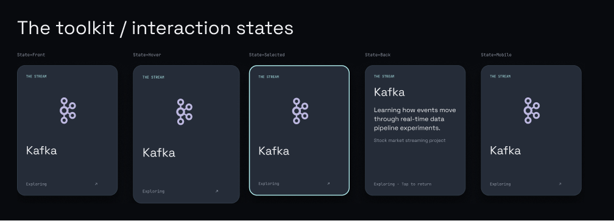

# Inside the Workspace

Muhammad Sheheryar’s interactive portfolio: begin inside a working terminal, scroll out of a CSS 3D computer, and explore a deck of flipping technical skill cards.

[Source repository](https://github.com/shehar-e-yaar/inside-the-workspace) · [Editable Figma design](https://www.figma.com/design/3zLiGlrMVFqsEELo6zw05g?node-id=6-900)

**Status:** Working React implementation, editable Figma design, passing production build and command tests. Desktop and mobile browser checks completed for the main controls. AWS deployment is intentionally deferred to the final stage; real-device swipe and reduced-motion checks remain outstanding.

## Run locally

Requires Node.js 22.12+ (or a newer supported Node LTS) and npm.

```sh
npm ci
npm run dev
```

Open http://127.0.0.1:5173/. For production:

```sh
npm test
npm run build
npm run preview
```

## The experience

- **Terminal:** safe predefined registry for help, whoami, about, skills, projects, certifications, github, contact, clear, date, and neofetch. Arrow-key history, Tab completion, Ctrl+L clearing, and touch shortcuts. Terminal output uses text rendering rather than HTML injection. No shell execution.
- **Computer reveal:** Motion scroll progress maps the native scroll position to CSS perspective, scale, rotation and reveal opacity. The page scrolls normally and reverses the animation when scrolling up. Skip intro is always available.
- **Skill deck:** six Data & Pipelines cards and nine Tools & Cloud cards, including SQL, Airflow and dbt in both relevant collections. Fan spacing adjusts to the collection size. Spring-driven hover elevation, adjacent-card response, and actual CSS 180-degree flips remain available. Mobile uses swipe navigation plus previous/next buttons and tap to flip.
- **Projects:** short repository-linked editorial index. Learning projects, exploration and research reproductions are labeled honestly.
- **Credentials:** four supplied original certificate images, lazy loaded. Native modal dialog supports Escape, arrows, close button, focus return and browser-managed focus containment.
- **Accessibility:** semantic sections, alternative navigation, focus outlines, named controls and reduced-motion fallbacks. Manual assistive-technology verification remains required.

## Stack

React, TypeScript, Vite, Motion for React, CSS 3D transforms, Lucide icons, locally bundled Space Grotesk / JetBrains Mono. No database, authentication, backend or API key is needed. Motion supplies scroll and spring behavior; adding GSAP would duplicate those responsibilities.

## AWS Amplify

`amplify.yml` installs from the lockfile, runs tests, builds the app, and publishes `dist`. Deployment instructions are in [docs/DEPLOYMENT.md](docs/DEPLOYMENT.md). AWS hosting is deferred at the owner's request. No AWS resources were created; no public hosting URL or authentic AWS screenshots exist yet.

Architecture: visitor → Amplify Hosting HTTPS/CDN → static Vite output → browser-local terminal, scroll scene and skills deck. GitHub main branch → Amplify build → hosted static assets. This is the intended deployment architecture, not verified deployed infrastructure.

## Design and screenshots

[Editable Figma design](https://www.figma.com/design/3zLiGlrMVFqsEELo6zw05g?node-id=6-900) contains 1440 px desktop and 390 px mobile screens, five connected computer-reveal states, scoped design tokens, shared typography/effects, original logo components, five skill-card variants and the four original certificate artworks. [Design handoff](docs/DESIGN.md) records the specification and node links.

Browser verification covered terminal input, history and autocomplete, desktop card flipping, certificate navigation and Escape close, mobile navigation, next-card browsing, tap-equivalent flips and absence of horizontal page overflow at 390 px. It exposed two issues that were fixed: reveal opacity lag and focus-induced mobile-deck scrolling. Physical touch-swipe and assistive-technology checks remain pending. See [verification details](docs/READINESS.md).

Figma design renders (these are design evidence, not browser screenshots):



## Content provenance

The user's mission brief supplies education and personal direction. Public repositories were inspected on November 2, 2026: [profile](https://github.com/shehar-e-yaar), [previous portfolio](https://github.com/shehar-e-yaar/Resume), [data projects](https://github.com/shehar-e-yaar/Data_Engineering_Projects), [HeatShield](https://github.com/shehar-e-yaar/HeatShield), [OmbudsAI](https://github.com/shehar-e-yaar/Ombuds-AI), and [research explorations](https://github.com/shehar-e-yaar/RESEARCH_WORK). Email and LinkedIn were recovered from the previous portfolio source. No employment, competition win or publication is claimed. FortyGuard recognition is described as completion / demonstrated excellence.

## Challenges and learnings

- A real terminal requires a bounded command registry, careful keyboard behavior and literal output rendering. The tests include prototype-property names and script-like input.
- The visual concept uses layered CSS geometry and transforms instead of a WebGL renderer, keeping the implementation simpler and making a static hosting deployment possible.
- Touch interaction needs an explicit navigation alternative to hover; the deck has both swipe and accessible arrow buttons.
- Account access initially blocked design work. After access was restored, the editable Figma screens and components were completed. The implementation came first because of that initial block; the later design pass inspected and refined the shared visual specification.
- Real browser checks found that opacity timelines could lag behind computer transforms. A direct Motion scroll subscription now updates CSS opacity variables. Focus could also scroll a clipped mobile deck; using a non-scrolling clip container keeps the selected card centered.
- The automatic page-to-Figma capture timed out. The final Figma UI was authored as native editable layers, with certificate artwork uploaded separately after explicit approval.

## Credits

- Original portfolio composition and code authored for this brief.
- Technology marks: Simple Icons (CC0 project; brand marks remain subject to brand policies) and Devicon (MIT). The SQL symbol and AWS lettering illustration are local SVG artwork. Technology names and marks identify their respective tools and do not imply endorsement.
- Space Grotesk and JetBrains Mono: SIL Open Font License, bundled through Fontsource.
- Lucide: ISC. React: MIT. Motion: MIT. Vite and TypeScript: their distributed open-source licenses.
- Certificates are supplied original personal credential assets.

Submission draft and walkthrough: [docs/SUBMISSION.md](docs/SUBMISSION.md).
