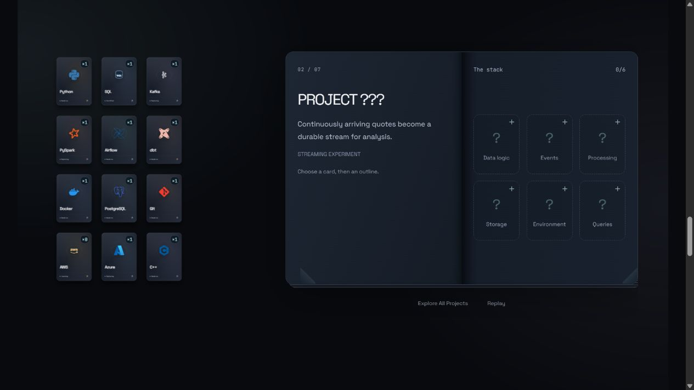
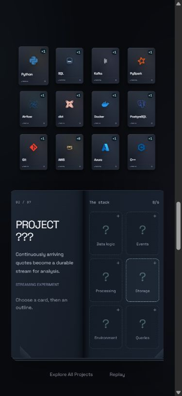

# Project Forge: Build to Reveal

Current local revision, November 4, 2026. No push or deployment.

The original twelve-card discovery has been restored from the saved implementation: original artwork, click-through reducer, front/back content, fan coordinates, resting-coordinate hover mapping, 220/240ms cycling and 850ms unfolding. Quantity badges appear only after discovery. There is one keyed card instance per skill throughout the scroll journey. Motion transforms on its wrapper interpolate the existing fan/carousel into a 3×4 desktop inventory and 4×3 compact mobile inventory. Reverse scrolling returns those same cards to their original arrangement. No replacement inventory is mounted.

The compact book emerges alongside the inventory. Docking completes in the first 65% of the short scroll scene, leaving a stable shared workspace. Card identity, discovery, inventory and assignments survive the transition. Reduced motion uses discrete wrapper positions and immediate book transitions. The existing palette, fonts, terminal, navigation, About and certificates remain in place.

## Mystery game

Pages use genuine project categories, short source-based clues and portrait role slots. Project identity comes from `mysteryLabel`, which returns `PROJECT ???` until every real required slot is assigned. Locked pages conceal the title from visible content, group labels, assignment/removal labels and terminal-return labels. Repository links are rendered only after completion. Internal stable IDs and bundled project data are not a security boundary; the explicit Explore All Projects mode deliberately provides public access to every project.

Choose an original inventory card, then its role outline, or drag it into the slot. Wrong cards cannot consume tokens. Valid assignment updates the shared inventory and badges immediately; a token flight/settle and brief cyan completed-state glow accompany insertion. Removing a card restores one copy and returns the page to mystery state. A zero-supply slot reuses the original terminal, with a suggested command and return to the same unfinished page. Neither cover opening nor quick browsing creates tokens or changes assignments.

The cover title is Project Forge with Build to Reveal subtitle. Cover dragging is proportional to the pointer. Cover/page drags complete beyond a threshold and cancel back for incomplete pulls; corner clicks and keyboard controls remain alternatives. Native modal dialogs provide direct browsing and confirmed Replay. Browsing is available during discovery as well as while docked. Replay resets only Forge state and brings the visitor back to the original first card.

## Files and integration

- `src/ForgeWorkspace.tsx`: restored original cards; shared-store discovery; wrapper transforms, docking, original-card dragging, token flight and terminal-return focus.
- `src/ProjectForge.tsx`: compact pointer-driven cover/book, mystery slots/reveal, index and Replay dialogs.
- `src/mystery.ts`: genuine clues, role names and a single completion-gated identity helper.
- `src/mystery.test.ts`: identity concealment, final-assignment reveal, removal/relock and clue coverage.
- `src/App.tsx`: workspace replaces the temporary static skills strip and isolated book; terminal return uses the same identity gate.
- `src/style.css`: scoped journey, dock, mystery, slot and mobile treatments.
- Existing `forgeState`, `ForgeProvider`, terminal registry, quantity limits and versioned persistence remain authoritative. Completion is derived, not stored separately.

## Figma

[Editable Build to Reveal storyboard](https://www.figma.com/design/3zLiGlrMVFqsEELo6zw05g?node-id=29-568).

Sixteen native editable state frames reuse existing Workspace variables and original card instances: stack, discovery, fan, badges, two scroll intermediates, dock/book, cover, opening, mystery, portrait role slots, selected/dragging intent, fill, reveal, terminal return and compact mobile composition. The stock-streaming page uses all six genuine requirements. These are design and motion-reference states; the actual game runs in React.

## Verification

- 51 automated tests passed across six files, including existing inventory, terminal, deck and hover checks, plus mystery concealment/relock checks.
- TypeScript and Vite production build passed; no dependencies added; Amplify configuration unchanged.
- Browser: confirmed Replay resets to Python 1/12; all twelve clicks work; expansion produces badges; scroll docks the same card elements; original Python card drag consumes a token; final valid assignment reveals VenomLink; removing AWS hides the title/link again; selecting the original AWS card and its slot reveals it again.
- Browser: draggable cover opening, keyboard page flipping, seven-project quick index, exhausted Python terminal prefill, live forge output and return to mystery page 2 with the same empty slots and assignments preserved.
- Browser at 390×844: all twelve docked card bounds fit inside the content width; compact cover and mystery book fit vertically; cover drag tested with mouse input at this viewport. Physical touch hardware and screen-reader testing remain unperformed.
- No measured 60 FPS claim. Browser-sized testing does not establish physical touch behavior.

