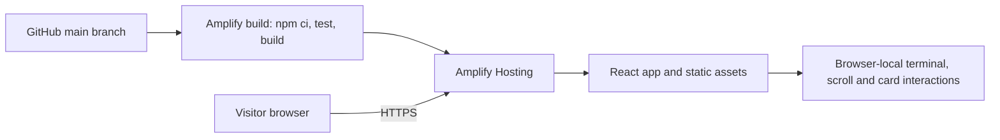

# Publish with AWS Amplify Hosting

## Current access

GitHub authentication now succeeds as `shehar-e-yaar`. AWS deployment is deferred until the final stage at the owner's request. No AWS connector or AWS CLI is available in this session, and no AWS resources have been created. Never place account credentials in source or chat.

## GitHub + continuous deployment

1. Use [shehar-e-yaar/inside-the-workspace](https://github.com/shehar-e-yaar/inside-the-workspace). Future source changes should be committed and pushed to `main`; exclude `node_modules`, `.env` files and `dist`. The provided `.gitignore` covers those outputs.
2. Sign in to your AWS account and open AWS Amplify. Choose **Create new app**, select GitHub as the source, and authorize the specific repository. Choose its `main` branch.
3. Confirm the root app directory and repository `amplify.yml`. Use a supported Node LTS build image with Node 22.12 or later. The build installs with `npm ci`, tests with `npm run test`, runs `npm run build` and publishes `dist`.
4. Review the hosting charges shown by AWS, then deploy. Keep the hosted branch accessible through judging. Do not disconnect/delete it after submitting.
5. Open the returned public HTTPS URL in a signed-out browser and on a phone. Test terminal, scroll reversal, skill flips/swipes, menu, repository links and every certificate.
6. Save the real URL in the README and submission draft. Add absolute production Open Graph image / URL metadata after the hosting domain is known. Capture actual successful-build and hosting-domain screenshots.

This app uses section anchors and no client-side routes. No catch-all rewrite is needed for the current URL structure. It does not require environment variables, Amplify backend generation, Cognito, Lambda or a database.

## Manual deployment alternative

If GitHub authorization cannot be completed, build locally with `npm ci`, `npm test`, and `npm run build`. In Amplify's deploy-without-Git workflow, upload a ZIP of **the contents** of `dist`, with `index.html` at the archive root. Continuous deployment remains the preferred path. Test the resulting HTTPS URL and retain evidence.

## Architecture evidence

Include one small architecture graphic in the submission:

Label the architecture as deployed only after verifying the AWS app and public URL. Capture AWS configuration yourself if the account cannot be connected; no configuration screenshot may be fabricated.

## Reference

[AWS Amplify build settings](https://docs.aws.amazon.com/amplify/latest/userguide/build-settings.html) explains repository-owned `amplify.yml` configuration.
