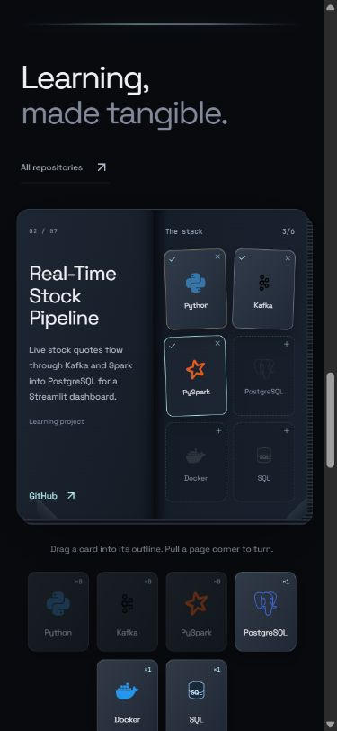
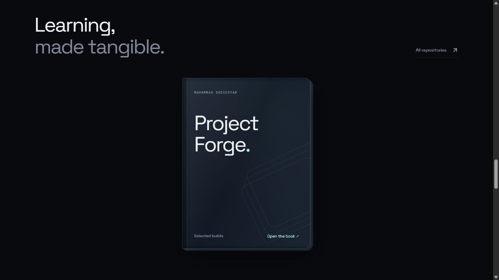
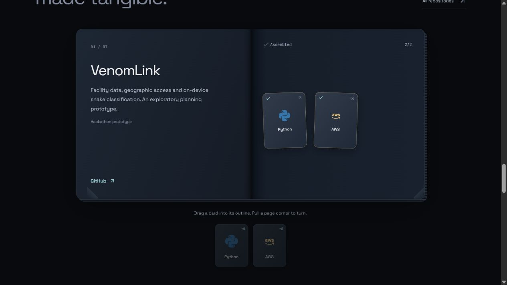

# Project Forge — compact book revision

Updated locally November 4, 2026, following the user's six visual corrections. No GitHub push or AWS deployment.

## What changed

- Removed the separate large skill-card carousel. Skills navigation now leads to a compact logo/name strip. Collectible cards appear only for the currently open project's requirements.
- Removed the twelve-item inventory panel, introductory feature text, assembly instructions, architecture diagram/dialog/actions, visible Previous/Next controls, save-status footer and reset control.
- Added a titled Project Forge cover with an opening animation. Opening activates the shared inventory directly; the removed twelve-card discovery is no longer required.
- Replaced the 850px project panels with a compact two-leaf book: 430px minimum at desktop and 355px at mobile widths. Seven real projects retain their repository links and concise truthful summaries.
- Changed horizontal slots to portrait card outlines. Assigned cards retain the existing dark glass/card language and technology artwork.
- Page corners follow a horizontal pointer pull with a 3D sheet, front/back faces, perspective and hinge shadow. Small corner clicks also turn pages. Left/right arrow keys provide an alternative. Turning back from the first project closes the cover; the final project cannot turn forward.
- Only relevant technology cards appear beneath the open book. Desktop pointer dragging carries a real card ghost and validates the drop against slot IDs. Mobile tap selection and direct-slot assignment remain supported. Assigned slots return one token. Empty supply opens the existing terminal replenishment flow.

The original `inventory`/`forge` commands, supply caps, versioned save validation, assignments and quantities remain shared through `ForgeProvider` and `forgeState`. Completion is still derived from assignments. Existing saved assignments survive this revision. The old deck reducer remains for backward-compatible save normalization; it is no longer rendered as a separate carousel. No new dependencies.

## Files

- `src/ProjectForge.tsx`: compact cover, portrait slots, project-specific cards, pointer-driven page turns and card dragging; removed architecture and footer UI.
- `src/folioNavigation.ts` / `.test.ts`: bounded page destinations, directional pull progress and commit/cancel thresholds.
- `src/App.tsx`: standalone deck replaced by compact technology strip.
- `src/style.css`: previous Forge-specific presentation replaced with scoped folio styling.
- `src/forgeState.ts`: cover activation without resetting inventory; page changes clear stale feedback.
- `src/forgeState.test.ts`: updated activation wording. Existing invariant tests remain.
- `README.md`: describes the current local experience.

## Motion and accessibility

Cover opening takes 700ms; committed page turns use the remaining fraction of 650ms, with a 200ms minimum. Incomplete pulls return over 320ms. The pointer directly controls the rotation of a half-width sheet. Movement uses transform/opacity; no new continuous loops. Reduced motion makes cover/page transitions immediate and removes hover movement. Animations and timers stop on unmount.

Corners are native controls with accessible names and visible focus, without visible button text. The book is focusable and supports left/right keys. Slots and source cards have labelled actions and real quantities. Quiet success/selection updates remain in a screen-reader live region; meaningful errors stay visible. Physical touch and assistive-technology testing remain unperformed.

## Verification

- 48 automated tests passed across five files, covering inventory conservation, command validation, save recovery, cover activation and page navigation geometry/boundaries.
- TypeScript and Vite production build passed.
- Browser at normal desktop width: cover opening, forward and backward corner dragging, an Airflow card dragged into its matching slot, wrong PostgreSQL-to-Python drop rejection without consumption.
- Browser at 390×844: compact portrait slots, select-then-assign PySpark, live quantity updates, keyboard turning and return to cover. This is browser-sized/tap-equivalent testing, not physical-device touch testing.
- Final browser console checked for errors. No measured FPS claim.
- No architecture UI, large inventory panel, standalone carousel, visible Next/Previous buttons, save footer or reset control remains in the project experience.

Current browser evidence:

`docs/figma-forge-state.json` and `project-forge-figma.png` are the previous design iteration. This revision did not modify the Figma file.
